<div align="center">
  
</div>

<p align="center">
  
  
  
  
</p>

<p align="center"><i>I develop multi-task deep learning architectures, 2D medical vision pipelines, and decentralized graph neural networks.<br>
Final-year Master's student at ESI-SBA (Algeria 🇩🇿), actively interviewing for a 6-month AI Research PFE starting Feb/Mar 2027.</i></p>


<br><br>


<div align="center">
  
</div>

<p align="center">
  <a href="https://multimodal-brain-tumor-diagnostics.vercel.app/"></a>
  <a href="https://drive.google.com/file/d/1BGBiM9NWthjeNTqe7vRC0PhU4XXtyTR6/view?usp=sharing"></a>
  <a href="https://github.com/AimenAbdesslame/CINEMATCH_movie-recommender-system"></a>
  <a href="https://github.com/AimenAbdesslame/E-VENTI_Front-End"></a>
</p>

<br>


<a href="https://github.com/AimenAbdesslame/multimodal-brain-tumor-diagnostics"></a>

<details>
<summary><b>How the research pipeline fits together</b> (architecture)</summary>
<br>

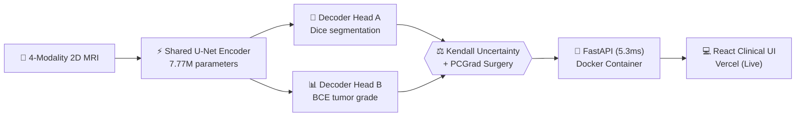

</details>

<a href="https://github.com/AimenAbdesslame/gnn_drone_project"></a>
<p align="center">
  <a href="https://github.com/AimenAbdesslame/gnn_drone_project"></a>
</p>

<table>
<tr>
<td width="50%" align="center">
  <a href="https://github.com/AimenAbdesslame/CINEMATCH_movie-recommender-system"></a><br>
  <a href="https://github.com/AimenAbdesslame/CINEMATCH_movie-recommender-system"></a>
</td>
<td width="50%" align="center">
  <a href="https://github.com/AimenAbdesslame/breast-cancer-unsupervised-app"></a><br>
  <a href="https://github.com/AimenAbdesslame/breast-cancer-unsupervised-app"></a>
</td>
</tr>
<tr>
<td align="center">
  <a href="https://github.com/AimenAbdesslame/Linear_Regression_from_Scratch__No_ML_Libraries"></a><br>
  <a href="https://github.com/AimenAbdesslame/Linear_Regression_from_Scratch__No_ML_Libraries"></a>
</td>
<td align="center">
  <a href="https://github.com/AimenAbdesslame/Logistic_Regression_from_Scratch__No_ML_Libraries"></a><br>
  <a href="https://github.com/AimenAbdesslame/Logistic_Regression_from_Scratch__No_ML_Libraries"></a>
</td>
</tr>
</table>

<br>


<table>
<tr>
<td width="50%" align="center">
  <a href="https://github.com/AimenAbdesslame/IASD-university-projects-Labs-S1"></a><br>
  <a href="https://github.com/AimenAbdesslame/IASD-university-projects-Labs-S1"></a>
</td>
<td width="50%" align="center">
  <a href="https://github.com/AimenAbdesslame/IASD-university-projects-Labs-S2"></a><br>
  <a href="https://github.com/AimenAbdesslame/IASD-university-projects-Labs-S2"></a>
</td>
</tr>
</table>

<br>


<table>
<tr>
<td width="50%" align="center">
  <a href="https://github.com/AimenAbdesslame/E-VENTI_Front-End"></a><br>
  <a href="https://github.com/AimenAbdesslame/E-VENTI_Front-End"></a>
</td>
<td width="50%" align="center">
  <a href="https://github.com/AimenAbdesslame/social_media_react"></a><br>
  <a href="https://github.com/AimenAbdesslame/social_media_react"></a>
</td>
</tr>
<tr>
<td align="center">
  <a href="https://github.com/AimenAbdesslame/Fitness_Supplements_app"></a><br>
  <a href="https://github.com/AimenAbdesslame/Fitness_Supplements_app"></a>
</td>
<td align="center">
  <a href="https://github.com/AimenAbdesslame/numpy-100-exercises-solutions"></a><br>
  <a href="https://github.com/AimenAbdesslame/Socket-TCP_networking"></a>
</td>
</tr>
</table>

<details>
<summary><b>More experiments</b> · university labs, data pipelines & notebooks</summary>
<br>

- [`IASD-university-projects-Labs-S1`](https://github.com/AimenAbdesslame/IASD-university-projects-Labs-S1): S1 university curriculum labs, algorithmic foundations, probabilistic models
- [`IASD-university-projects-Labs-S2`](https://github.com/AimenAbdesslame/IASD-university-projects-Labs-S2): S2 university labs in computer vision, deep learning pipelines, optimization
- [`paris-2024-olympics-dashboard`](https://github.com/AimenAbdesslame/paris-2024-olympics-dashboard): Olympic games data analysis, metric exploration, interactive visualization
- [`Socket-TCP_networking`](https://github.com/AimenAbdesslame/Socket-TCP_networking): Asynchronous client/server network transport layer in TypeScript
- [`numpy-100-exercises-solutions`](https://github.com/AimenAbdesslame/numpy-100-exercises-solutions): Comprehensive 100-problem benchmark suite covering advanced vectorized operations

</details>

<br>


```text
$ traceroute --story aimen

 hop  where                                     what happened
 ───  ────────────────────────────────────────  ──────────────────────────────────────────────
  1   ESI-SBA · 2021 → now                      Integrated Preparatory Cycle & Engineering Degree
  2   IASD Master's Track · 2025 → 2027         Specialization: Artificial Intelligence & Data Science
  3   Foundations · 2024–25                     NumPy from-scratch ML, TCP sockets, 100 numerical labs
  4   Full-Stack Systems · 2023                 Shipped E-VENTI, Social Media React, Fitness web apps
  5   EnoGeo internship  (Sonatrach subsidiary)· 2024                Data analysis, pipeline & discovery of departements rely them with ai
  6   Team R&D · 2026                           GNN Drone Swarm Optimization: multi-agent spatial coordination
  7   Solo Research Lead · 2026                 BraTS20 Dual-Head U-Net: Kendall uncertainty + PCGrad surgery
  8   → I am here                            seeking 6-month Master's PFE in AI / Deep Learning (Feb/Mar 2027)

 trace complete. destination reachable.
```

<br>


<div align="center">
  
</div>

<br>

<table>
<tr>
<td width="170"><b>Languages</b></td>
<td><br><sub><code>Python (Scientific Computing)</code> <code>Modern C++</code> <code>C</code> <code>TypeScript</code> <code>SQL</code></sub></td>
</tr>
<tr>
<td><b>ML &amp; Deep Learning</b></td>
<td><br><sub><code>PyTorch Geometric</code> <code>CNNs &amp; U-Net</code> <code>Graph Neural Networks</code> <code>Multi-Task Learning</code> <code>Reinforcement Learning (RL)</code> <code>Medical Vision</code></sub></td>
</tr>
<tr>
<td><b>Transformers &amp; LLMs</b></td>
<td><br><sub><code>Hugging Face Transformers</code> <code>LLM Fine-Tuning (LoRA / QLoRA)</code> <code>RAG Systems</code> <code>Prompt Engineering</code> <code>Vector Embeddings</code> <code>LangChain &amp; LlamaIndex</code></sub></td>
</tr>
<tr>
<td><b>AI Engineering &amp; MLOps</b></td>
<td><br><sub><code>FastAPI Microservices (5.3ms)</code> <code>Docker Deployment</code> <code>Weights &amp; Biases (W&amp;B)</code> <code>MLflow Tracking</code> <code>ONNX Runtime</code> <code>Vector Databases (Chroma / Pinecone)</code></sub></td>
</tr>
<tr>
<td><b>Data Analytics &amp; BI</b></td>
<td><br><sub><code>Data Cleaning &amp; Imputation</code> <code>Power BI Dashboards</code> <code>Exploratory Data Analysis (EDA)</code> <code>Feature Engineering</code> <code>Statistical Modeling</code></sub></td>
</tr>
<tr>
<td><b>Web &amp; Backend</b></td>
<td><br><sub><code>RESTful APIs</code> <code>React / Next.js</code> <code>Interactive Clinical Dashboards</code> <code>TypeScript</code></sub></td>
</tr>
<tr>
<td><b>Tools &amp; DevOps</b></td>
<td><br><sub><code>Linux Environments</code> <code>Git &amp; GitHub Workflows</code> <code>CI/CD Pipelines</code> <code>Bash Scripting</code></sub></td>
</tr>
<tr>
<td><b>Core Math &amp; Theory</b></td>
<td><code>Machine Learning (ML)</code> <code>Deep Learning</code> <code>Reinforcement Learning</code> <code>Data Cleaning &amp; Preprocessing</code> <code>Data Visualization (Power BI)</code> <code>Multi-Task Learning</code> <code>Graph Neural Networks</code> <code>Medical Image Segmentation</code> <code>Homoscedastic Uncertainty</code> <code>Gradient Surgery</code></td>
</tr>
<tr>
<td><b>Soft Skills</b></td>
<td>Research synthesis · technical writing · experimental rigor · cross-functional collaboration · agile delivery</td>
</tr>
</table>

<br>


- 🧠 **BraTS 2020 Multi-Task Research Lead**: Dual-Head U-Net on 2D MRI, 0.726 Dice, 0.962 ROC-AUC, -41% latency (5.3ms/slice)
- 🚁 **GNN Swarm Optimization Co-Author**: Decentralized multi-agent spatial coordination using PyTorch Geometric & MARL
- 🎓 **ESI-SBA IASD Track**: M.Sc. in AI & Data Science, specialized in deep learning, medical computer vision & graph learning
- 🔬 **First-Principles ML**: Vectorized gradient descent & classification engines written purely from scratch in NumPy
- 🌍 **PFE Availability**: Actively seeking a 6-month Master's PFE (End-of-Studies Internship) in European R&D labs starting Feb/Mar 2027

<br>


<p align="center">
  <a href="https://www.linkedin.com/in/aimen-abdesselam-bab937223/"></a>
  <a href="https://multimodal-brain-tumor-diagnostics.vercel.app/"></a>
  <a href="mailto:aimen.abdesselam@outlook.com"></a>
</p>

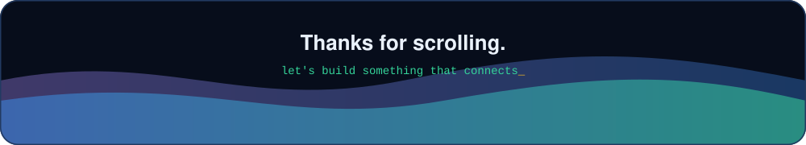
